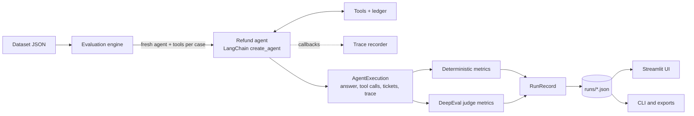

# TraceGrade

**An evaluation workbench for tool-using LangChain agents.** TraceGrade runs an agent over a
dataset of scenarios, records exactly what it did (answers, tool calls, arguments, side
effects, a full execution trace), and scores every run with two complementary kinds of
metric:

* **Deterministic checks** — exact, free, repeatable: did the agent issue the right refund,
  call the expected tools with the expected arguments in the expected order, avoid
  forbidden tools, and tell the truth about what it did?
* **LLM-as-a-judge metrics** (via [DeepEval](https://github.com/confident-ai/deepeval)) —
  task completion, step efficiency, plan quality, plan adherence, argument correctness and
  answer correctness, each with the judge's reason.

Every run is stored, can be inspected case by case, compared with another run, resumed if
interrupted, and exported as JSON, CSV or Markdown. A Streamlit interface and a CLI share
the same engine.

The bundled **system under test** is a customer-support refund agent built with
LangChain's `create_agent`: it looks up purchase history, checks a 30-day refund window,
calculates refunds and issues tickets. The bundled dataset contains 16 synthetic scenarios
(eligible and ineligible refunds, partial requests, unknown customers, quotes,
future-dated purchases, the 30-day boundary and a prompt-injection attempt).

> TraceGrade works **out of the box without any API key**: the agent can run on a
> deterministic, rule-based *offline reference model*, which exercises the real agent
> graph, tools, metrics and storage. That model is clearly labelled everywhere — it
> verifies the pipeline and the dataset, not LLM quality. Add a Groq or OpenAI key to
> evaluate a real model and to enable the LLM-judge metrics.

---

## Contents

- [Quick start](#quick-start)
- [Using a real LLM](#using-a-real-llm)
- [The web interface](#the-web-interface)
- [Command-line interface](#command-line-interface)
- [Metrics](#metrics)
- [Datasets](#datasets)
- [How it works](#how-it-works)
- [Configuration reference](#configuration-reference)
- [Development](#development)
- [Project layout](#project-layout)
- [Limitations](#limitations)
- [Troubleshooting](#troubleshooting)
- [Documentation](#documentation)

## Quick start

Requirements: **Python 3.12 or 3.13**. [uv](https://docs.astral.sh/uv/) is recommended (it is
used automatically when installed) but not required.

```bash
python start.py
```

That one command does everything: creates `.env` from `.env.example` if you have none,
installs the exact locked dependencies, checks the configuration, starts the web interface and
opens it in your browser (default <http://localhost:8501>; the next free port is used if that
one is busy). Stop it with Ctrl+C. Options: `--port 8600`, `--no-browser`, `--setup-only`.

Prefer the command line? After the first start:

```bash
uv run tracegrade evaluate
```

evaluates the bundled refund agent on all 16 scenarios (offline by default) and saves the run
under `runs/`.

<details>
<summary>Without uv (plain pip)</summary>

```bash
python -m venv .venv
.venv\Scripts\activate          # Windows; on macOS/Linux: source .venv/bin/activate
pip install -r requirements.txt
pip install -e . --no-deps
tracegrade evaluate
```

`requirements.txt` is exported from `uv.lock` and pins the exact tested versions.
</details>

## Using a real LLM

1. Open `.env` (created by `python start.py`; or copy `.env.example`) and add a key:

   ```dotenv
   GROQ_API_KEY=gsk_...
   TRACEGRADE_AGENT_PROVIDER=groq
   TRACEGRADE_JUDGE_PROVIDER=groq
   ```

2. Check the configuration (no API call is made unless you add `--ping`):

   ```bash
   uv run tracegrade doctor
   ```

3. Run an evaluation with the agent and the judge on Groq:

   ```bash
   uv run tracegrade evaluate --agent-provider groq --judge-provider groq
   ```

   Or simply restart `python start.py` and pick Groq on the *New evaluation* page. On Groq's
   on-demand tier (about 8,000 tokens per minute) use `--concurrency 1`; runs with judge
   metrics take minutes per case, and rate-limited calls are retried automatically.

Supported providers: `offline`, `groq` (default agent model `qwen/qwen3.8-27b`, judge `openai/gpt-oss-120b`) and `openai`
(default model `gpt-5.4`). Override models with `--agent-model` / `--judge-model` or the
`TRACEGRADE_AGENT_MODEL` / `TRACEGRADE_JUDGE_MODEL` variables. The agent model must support
tool calling.

**Cost and data flow.** A real run sends each scenario's customer message, the dataset's
purchase records (through tool results) and the system prompt to the agent provider, and
the execution trace to the judge provider. A full run makes roughly 4–6 agent calls per
case plus one or more judge calls per case and judge metric. The bundled data is synthetic.

## The web interface

| Page | What you do there |
|---|---|
| **Overview** | Purpose, provider readiness, latest run at a glance, recent runs |
| **New evaluation** | Choose dataset (or upload one), cases, agent provider/model, policy mode, judge, metrics and thresholds; validation before running; live per-case progress |
| **Run results** | Summary metrics, outcome charts, case × metric grid, per-case details (answer vs. reference, every metric's reason, tool calls with outputs, tickets, the trace the judge saw), exports, run history |
| **Compare runs** | Metric deltas, regressions/improvements per case, compatibility warnings |
| **Agent playground** | Multi-turn chat with the refund agent, showing its tool calls and tickets |
| **Datasets** | Browse cases and purchase records, see what the policy code decides for a case, schema reference, validate a file |
| **Settings & help** | Provider status, effective configuration (secrets never shown), opt-in connection test, metric reference, troubleshooting |

## Command-line interface

```text
tracegrade evaluate [--dataset SPEC] [--cases a,b] [--agent-provider P] [--agent-model M]
                    [--judge-provider P] [--judge-model M] [--suite deterministic|judge|all |
                    --metrics id,id] [--threshold id=0.8] [--policy-mode enforced|prompt_only]
                    [--concurrency N] [--label TEXT] [--fail-on-failure] [--quiet]
tracegrade resume RUN_ID [--retry-errors]
tracegrade runs list | show RUN_ID | export RUN_ID --format json|csv|cases-csv|md [--output F]
               | compare BASELINE CANDIDATE | delete RUN_ID --yes
tracegrade dataset list | validate SPEC | show [SPEC]
tracegrade metrics
tracegrade doctor [--ping]
tracegrade chat [--provider P] [--model M] [--real-date]
tracegrade ui [--port 8501]
```

Exit codes: `0` success, `1` run incomplete or (with `--fail-on-failure`) failures,
`2` configuration/usage error, `130` interrupted. `--fail-on-failure` makes `evaluate`
usable as a CI gate.

## Metrics

| Metric | Kind | Default threshold | Checks |
|---|---|---:|---|
| `refund_outcome` | deterministic | 1.0 | Tickets actually issued (tool ledger) equal the expected refund, or none |
| `expected_tool_coverage` | deterministic | 1.0 | Share of expected tool calls made |
| `forbidden_tool_avoidance` | deterministic | 1.0 | No forbidden tool was called |
| `tool_argument_match` | deterministic | 1.0 | Expected calls made with expected arguments (normalised, item lists order-insensitive) |
| `tool_order` | deterministic | 1.0 | Longest common subsequence of expected vs. called tools |
| `answer_action_consistency` | heuristic | 1.0 | Reply states the refunded amount / does not claim a ticket that was not issued |
| `deepeval_tool_correctness` | deterministic (DeepEval) | 0.9 | DeepEval's exact tool + parameter comparison |
| `task_completion` | LLM judge | 0.8 | Task accomplished under the refund rules (trace-based) |
| `step_efficiency` | LLM judge | 0.8 | No unnecessary steps (trace-based) |
| `plan_quality` | LLM judge | 0.8 | Quality of the plan expressed in the trace |
| `plan_adherence` | LLM judge | 0.8 | Actions follow the plan |
| `argument_correctness` | LLM judge | 0.9 | Tool arguments fit the request |
| `answer_correctness` | LLM judge | 0.8 | Reply reaches the reference answer's conclusion (GEval) |

A case **passes** a metric when `score >= threshold`. *Skipped* (metric not applicable, or
no judge) and *error* (could not be computed) never count as passes or failures. Mean
score and pass rate are reported per metric; TraceGrade intentionally does not merge
different metrics into one overall score. Judge scores are model opinions — read the
reasons. See the project book for formulas and known metric limitations.

## Datasets

A dataset is a single JSON file: purchase records, the reference date used as "today" by
the agent (for reproducibility), and the cases:

```json
{
  "schema_version": 1,
  "name": "my_dataset",
  "reference_date": "2026-11-20",
  "customers": {"C2001": {"headset": {"price": 49, "date": "2026-11-12"}}},
  "cases": [
    {
      "id": "refund-headset",
      "input": "I'm customer C2001, please refund my headset",
      "expected_output": "A refund ticket for $49 is issued.",
      "expected_refund_total": 49,
      "expected_tools": [
        {"name": "get_purchase_history", "input_parameters": {"customer_id": "C2001"}},
        {"name": "get_current_date"},
        {"name": "calculate_refund", "input_parameters": {"customer_id": "C2001", "items": [{"name": "headset"}]}},
        {"name": "issue_refund_ticket", "input_parameters": {"customer_id": "C2001", "amount": 49}}
      ],
      "forbidden_tools": []
    }
  ]
}
```

`expected_refund_total`: `0` = no ticket may be issued, a positive number = tickets must
total exactly that, omitted = not checked. Validate with
`uv run tracegrade dataset validate my_dataset.json`; use with
`uv run tracegrade evaluate --dataset my_dataset.json`, or upload it on the *New
evaluation* page (uploads are stored in `datasets/`).

## How it works



The agent runs **once per case**; every metric scores that same execution. In `enforced`
policy mode the tools themselves validate eligibility and ticket amounts (guardrails); in
`prompt_only` mode the policy lives only in the system prompt, which lets you measure how
well a model follows policy on its own.

## Configuration reference

All settings are environment variables (or `.env` in the working directory). See
[`.env.example`](.env.example) for the full annotated list.

| Variable | Default | Meaning |
|---|---|---|
| `TRACEGRADE_AGENT_PROVIDER` | `offline` | `offline`, `groq`, `openai` |
| `TRACEGRADE_AGENT_MODEL` | provider default | Agent model / offline variant (`reference`, `naive`) |
| `TRACEGRADE_POLICY_MODE` | `enforced` | `enforced` or `prompt_only` |
| `TRACEGRADE_JUDGE_PROVIDER` | `none` | `none`, `groq`, `openai` |
| `TRACEGRADE_JUDGE_MODEL` | provider default | Judge model |
| `TRACEGRADE_MAX_CONCURRENCY` | `2` | Cases evaluated in parallel |
| `TRACEGRADE_RUNS_DIR` | `runs` | Where run records are stored |
| `GROQ_API_KEY`, `OPENAI_API_KEY` | – | Provider credentials (never logged or stored) |

## Development

```bash
uv sync                                   # includes the dev group
uv run pytest                             # unit, integration and UI tests (offline)
uv run pytest --cov                       # with coverage
uv run ruff check src tests && uv run ruff format --check src tests
uv run mypy
uv run bandit -q -r src
uv run pip-audit
TRACEGRADE_RUN_LIVE_TESTS=1 uv run pytest tests/live -m live   # real API calls (needs keys)
```

Rebuild the project book (Markdown → HTML/PDF/DOCX):

```bash
uv run --group docs python docs/project_book/build_book.py
```

## Project layout

```text
src/tracegrade/
  config.py, errors.py, logging_utils.py, cli.py
  refund/        the system under test: records, policy, tools, prompt, agent
  providers/     provider registry, offline reference model, LangChain->DeepEval judge adapter
  evaluation/    dataset, execution, tracing, metrics/, engine, aggregate, storage, export, compare
  ui/            Streamlit app and pages
  resources/datasets/refund_support_v1.json
tests/           unit/, integration/, ui/, live/ (opt-in)
docs/            requirements, testing strategy, verification report, project book
start.py         one-step launcher
```

## Limitations

* The offline reference model parses English with simple rules; it is a pipeline check,
  not a model. Its scores carry no information about LLM quality.
* LLM-judge scores vary with the judge model and between runs, and small judge models make
  visible reasoning mistakes; DeepEval's plan metrics return 1.0 when the judge finds no plan
  in the trace. Read the reasons; gate on the deterministic metrics.
* The bundled dataset is small (16 single-turn cases) and synthetic.
* The Groq integration is verified live (agent and judge); the OpenAI integration is
  implemented and tested offline but not verified against the live API. Details in
  `docs/VERIFICATION_REPORT.md`.
* Free/on-demand provider tiers have low per-minute and per-day token limits; full runs with
  judge metrics on all cases can exceed a day's quota.
* Runs are stored as local JSON files; there is no multi-user server or authentication.
  Run the UI on localhost or behind your own access control.

## Troubleshooting

| Symptom | Fix |
|---|---|
| `GROQ_API_KEY is not set` | Add it to `.env` in the directory you start from; check with `tracegrade doctor` |
| Agent errors with 401 | Key invalid or revoked |
| 429 / timeouts | Lower `--concurrency`, raise `TRACEGRADE_AGENT_TIMEOUT_SECONDS` |
| All judge metrics "skipped" | No judge configured: `--judge-provider groq` |
| Run shows "interrupted" | `tracegrade resume <run_id>` |
| Unexpected refund refusals | "Today" is the dataset's reference date, not your clock |

## Documentation

* [`docs/project_book/PROJECT_BOOK.md`](docs/project_book/PROJECT_BOOK.md) — the complete
  technical book (also as PDF and DOCX)
* [`docs/PRODUCT_REQUIREMENTS.md`](docs/PRODUCT_REQUIREMENTS.md),
  [`docs/TESTING_STRATEGY.md`](docs/TESTING_STRATEGY.md),
  [`docs/VERIFICATION_REPORT.md`](docs/VERIFICATION_REPORT.md)

No open-source license has been chosen for this project yet; add one before distributing it.
