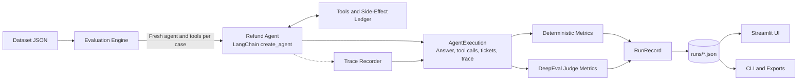
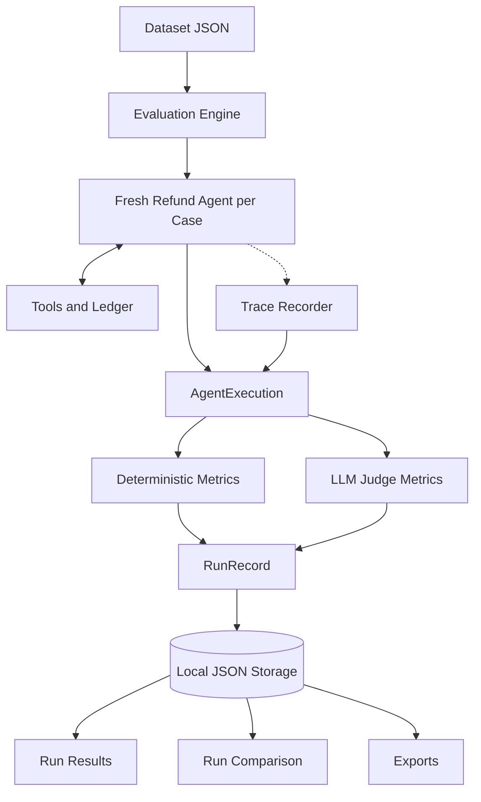

# TraceGrade

<div align="center">

###  Agent Evaluation & Execution Tracing

**A reproducible evaluation workbench for tool-using LangChain agents.**

Evaluate what AI agents do, not just what they say. TraceGrade executes agents against structured scenarios, captures tool calls, arguments, outputs, side effects, and execution traces, and evaluates behavior using deterministic checks and LLM-as-a-judge metrics.

[](https://www.python.org/)
[](https://python.langchain.com/)
[](https://streamlit.io/)
[](https://github.com/confident-ai/deepeval)
[](https://pytest.org/)

[Quick Start](#-quick-start) · [Architecture](#-architecture) · [Metrics](#-evaluation-metrics) · [CLI](#-command-line-interface) · [Testing](#-development-and-testing) · [Documentation](#-documentation)

</div>

---

TraceGrade is an evaluation workbench for **tool-using AI agents built with LangChain**.

An agent can produce a convincing answer while calling the wrong tools, violating business rules, using incorrect arguments, or claiming to have completed an action that never happened. TraceGrade makes these failures observable, measurable, and reproducible.

It executes agents over structured scenario datasets, records what happened during each execution, and scores every run using two complementary approaches:

- **Deterministic checks** — exact, repeatable verification of expected outcomes, tool calls, arguments, execution order, forbidden actions, and answer-action consistency.
- **LLM-as-a-judge** — model-based assessment of task completion, step efficiency, plan quality, plan adherence, argument correctness, and answer correctness, with explanations for the judge's decisions.

Every evaluation run is stored locally, can be inspected case by case, compared against another run, resumed if interrupted, and exported as JSON, CSV, or Markdown. A Streamlit interface and a CLI share the same evaluation engine.

> **Zero API keys required to get started.** TraceGrade includes a deterministic, rule-based offline reference model that exercises the real agent graph, tools, metrics, and storage pipeline. Offline results verify the pipeline and dataset, not LLM quality. Configure a Groq or OpenAI API key to evaluate a real model and enable LLM-judge metrics.

##  Key Features

| Feature | Description |
|---|---|
| **Execution tracing** | Capture agent answers, tool calls, arguments, outputs, side effects, refund tickets, and full execution traces. |
| **Deterministic evaluation** | Verify expected outcomes, tool coverage, argument correctness, tool order, forbidden tools, and answer-action consistency. |
| **LLM-as-a-judge** | Evaluate task completion, execution efficiency, planning quality, plan adherence, argument correctness, and answer correctness. |
| **DeepEval integration** | Use DeepEval-backed tool correctness and GEval-based answer correctness metrics. |
| **Scenario-based testing** | Define structured JSON datasets containing inputs, reference answers, expected tools, expected outcomes, and forbidden actions. |
| **Run persistence** | Store evaluation records locally for subsequent inspection and analysis. |
| **Run comparison** | Compare baseline and candidate runs, inspect metric deltas, and identify case-level regressions and improvements. |
| **Resume support** | Resume interrupted runs and optionally retry failed evaluations. |
| **Multiple export formats** | Export results to JSON, CSV, case-level CSV, and Markdown. |
| **Python-first interface** | Configure and inspect evaluations through a Streamlit web interface. |
| **Command-line automation** | Run evaluations, validate datasets, inspect results, and use evaluation failures as CI gates. |
| **Agent playground** | Interact with the refund agent across multiple turns while inspecting tool calls and tickets. |
| **Policy-mode comparison** | Compare tool-enforced guardrails with prompt-only policy instructions. |
| **Offline reference model** | Exercise the evaluation pipeline without requiring an external model API. |
| **Provider diagnostics** | Validate configuration and optionally test provider connectivity. |

> **Project note:** The bundled system under test is a customer-support refund agent built with LangChain's `create_agent`. It looks up purchase history, checks a 30-day refund window, calculates refunds, and issues tickets. The bundled dataset contains 16 synthetic scenarios.

---

## 📑 Contents

- [Architecture](#-architecture)
- [How it works](#-how-it-works)
- [Quick start](#-quick-start)
- [Using a real LLM](#-using-a-real-llm)
- [The web interface](#-the-web-interface)
- [Command-line interface](#-command-line-interface)
- [Metrics](#-evaluation-metrics)
- [Datasets](#-datasets)
- [Configuration reference](#-configuration-reference)
- [Development](#-development)
- [Project layout](#-project-layout)
- [Limitations](#-limitations)
- [Troubleshooting](#-troubleshooting)
- [Documentation](#-documentation)

---

##  Architecture

TraceGrade separates agent execution, trace recording, evaluation, aggregation, and result storage. Both the web interface and the command-line interface use the same underlying evaluation engine.

### System architecture



### Core components

| Component | Responsibility |
|---|---|
| **Dataset loader** | Loads and validates scenario datasets, customer records, reference dates, and expected behavior. |
| **Evaluation engine** | Coordinates agent execution, metric evaluation, aggregation, and persistence. |
| **Refund agent** | Executes the customer-support workflow using LangChain's `create_agent`. |
| **Tools and ledger** | Handle purchase-history lookup, date retrieval, refund calculations, ticket issuance, and records of actual side effects. |
| **Trace recorder** | Captures tool calls and execution behavior through the agent's tracing callbacks. |
| **Deterministic metrics** | Compare actual behavior with expected outcomes, tool calls, arguments, ordering, and constraints. |
| **DeepEval judge metrics** | Assess task completion, planning, execution efficiency, and answer correctness. |
| **Run storage** | Persists evaluation records as local JSON files. |
| **Streamlit interface** | Provides evaluation configuration, progress monitoring, results inspection, and run comparison. |
| **CLI** | Supports evaluation execution, dataset validation, diagnostics, run management, and exports. |

### Design principles

- Execute each scenario once and evaluate all selected metrics against that execution.
- Preserve case-level evidence instead of reporting only aggregate scores.
- Separate exact behavioral checks from subjective model judgments.
- Keep run records available for inspection, comparison, and resumption.
- Distinguish skipped metrics and computation errors from actual passes and failures.

See [`docs/project_book/PROJECT_BOOK.md`](docs/project_book/PROJECT_BOOK.md) for the complete architecture, scoring formulas, implementation details, and design trade-offs.

---

##  How it works

The evaluation lifecycle begins with a dataset and ends with an inspectable run record.

### Execution and evaluation flow



### Request and evaluation lifecycle

1. **Load the dataset.** Read scenario definitions, purchase records, the reference date, and expected behavior.
2. **Configure the evaluation.** Select cases, agent provider/model, policy mode, judge provider, metrics, thresholds, and concurrency.
3. **Execute the agent.** Create a fresh agent and tool context for each scenario.
4. **Record the execution.** Capture the final answer, tool calls, arguments, outputs, tickets, side effects, and trace.
5. **Evaluate behavior.** Run the selected deterministic and judge-based metrics against the same execution.
6. **Aggregate the results.** Preserve case-level results and calculate metric-level summaries.
7. **Persist the run.** Save the run record locally for inspection, comparison, and resumption.
8. **Inspect and export.** Review individual cases, understand metric explanations, compare runs, or export results.

### Policy modes

TraceGrade supports two policy modes:

- **`enforced`** — the tools validate refund eligibility and ticket amounts, providing tool-level guardrails.
- **`prompt_only`** — the policy exists in the system prompt, allowing evaluation of how well the model follows the instructions without the same tool-level enforcement.

The agent executes once per case, and every selected metric evaluates that same execution. This avoids independently rerunning the agent for each metric.

The distinction between policy modes is important: a correct outcome under enforced mode does not necessarily prove that the model independently understood or followed every policy rule.

---

##  Quick start

### Requirements

- **Python 3.12 or 3.13**
- [uv](https://docs.astral.sh/uv/) recommended, but not required
- Internet access for dependency installation
- An API key only when using a real model provider

### Option 1 — Start the application

From the project root:

```bash
python start.py
```

The launcher:

1. Creates `.env` from `.env.example` if no environment file exists.
2. Installs the locked dependencies.
3. Checks the configuration.
4. Starts the Streamlit interface.
5. Opens the application in your browser.

The default address is <http://localhost:8501>. If that port is busy, the next available port is used.

Additional options:

```bash
python start.py --port 8600
python start.py --no-browser
python start.py --setup-only
```

Stop the application with `Ctrl+C`.

### Option 2 — Run an evaluation from the CLI

After the initial setup:

```bash
uv run tracegrade evaluate
```

This evaluates the bundled refund agent against all 16 scenarios using the offline configuration by default. Results are saved under `runs/`.

### Option 3 — Install without uv

Create a virtual environment:

```bash
python -m venv .venv
```

Activate it on Windows:

```powershell
.venv\Scripts\activate
```

On macOS/Linux:

```bash
source .venv/bin/activate
```

Install the dependencies and local package:

```bash
pip install -r requirements.txt
pip install -e . --no-deps
tracegrade evaluate
```

`requirements.txt` is exported from `uv.lock` and pins the dependency versions represented by the lockfile.

---

##  Using a real LLM

TraceGrade supports the offline reference model and real model providers for agent execution and LLM-based judging.

### 1. Configure credentials

Open `.env`, created by `python start.py`, or copy `.env.example` to `.env`.

Example using Groq:

```dotenv
GROQ_API_KEY=your_groq_api_key
TRACEGRADE_AGENT_PROVIDER=groq
TRACEGRADE_JUDGE_PROVIDER=groq
```

Never place real credentials in source code or commit them to version control.

### 2. Validate configuration

```bash
uv run tracegrade doctor
```

No provider request is made unless `--ping` is supplied.

### 3. Run a real evaluation

```bash
uv run tracegrade evaluate --agent-provider groq --judge-provider groq
```

Alternatively, restart `python start.py` and select Groq on the **New evaluation** page.

### Supported providers

| Provider | Agent execution | Judge evaluation | Default model information |
|---|---|---|---|
| `offline` | Yes | No | Rule-based reference model; variants include `reference` and `naive`. |
| `groq` | Yes | Yes | Agent: `qwen/qwen3.8-27b`; judge: `openai/gpt-oss-120b`. |
| `openai` | Yes | Yes | Documented default model: `gpt-5.4`; judge model is configurable. |

The agent model must support tool calling. Override the models with `--agent-model` and `--judge-model`, or use the `TRACEGRADE_AGENT_MODEL` and `TRACEGRADE_JUDGE_MODEL` environment variables.

### Cost, rate limits, and data flow

A real run makes roughly 4–6 agent calls per case, plus one or more judge calls per case and judge metric.

On Groq's limited on-demand tier, start with `--concurrency 1`. Evaluations with judge metrics can take minutes per case, and a full run may exceed per-minute or daily token quotas. Rate-limited requests are retried automatically.

When real providers are enabled:

- The agent provider receives the scenario's customer message, relevant purchase records through tool results, and the system prompt.
- The judge provider receives the execution trace when judge evaluation is enabled.
- Provider usage may incur costs and is subject to the provider's data-handling policies.

The bundled data is synthetic. Review data flows and provider policies before evaluating private or production data.

---

##  The web interface

The Streamlit application covers the complete evaluation workflow.

| Page | What you can do |
|---|---|
| **Overview** | Review the project purpose, provider readiness, latest run, and recent activity. |
| **New evaluation** | Select a dataset or upload one, choose cases, configure the agent provider/model, policy mode, judge, metrics, and thresholds, validate settings, and monitor live per-case progress. |
| **Run results** | Inspect summary metrics, outcome charts, the case-by-metric grid, per-case answers versus references, metric explanations, tool calls and outputs, tickets, execution traces, exports, and run history. |
| **Compare runs** | Inspect metric deltas, case-level regressions and improvements, and compatibility warnings. |
| **Agent playground** | Chat with the refund agent across multiple turns and inspect tool calls and tickets. |
| **Datasets** | Browse cases and purchase records, inspect policy decisions, view the schema reference, and validate files. |
| **Settings & help** | Review provider status and effective configuration, test connections with opt-in requests, consult the metric reference, and troubleshoot errors. |

The UI and CLI share the same evaluation engine.

---

##  Evaluation metrics

TraceGrade uses deterministic checks, rule-based consistency checks, and LLM-as-a-judge metrics. These measure different aspects of agent quality and should be interpreted separately.

### Deterministic and rule-based metrics

| Metric | Kind | Default threshold | What it checks |
|---|---|---:|---|
| `refund_outcome` | Deterministic | 1.0 | Whether issued tickets match the expected refund total, or no ticket was issued when required. |
| `expected_tool_coverage` | Deterministic | 1.0 | Share of expected tool calls made. |
| `forbidden_tool_avoidance` | Deterministic | 1.0 | Whether the agent avoided forbidden tools. |
| `tool_argument_match` | Deterministic | 1.0 | Expected calls and arguments; normalized item lists are order-insensitive. |
| `tool_order` | Deterministic | 1.0 | Tool-sequence agreement using the longest common subsequence. |
| `answer_action_consistency` | Heuristic | 1.0 | Whether the answer states the refunded amount and avoids claiming an unissued ticket. |
| `deepeval_tool_correctness` | Deterministic (DeepEval) | 0.9 | DeepEval's exact tool and parameter comparison. |

### LLM-as-a-judge metrics

| Metric | Kind | Default threshold | What it checks |
|---|---|---:|---|
| `task_completion` | LLM judge | 0.8 | Whether the task was accomplished under the refund rules. |
| `step_efficiency` | LLM judge | 0.8 | Whether unnecessary execution steps were avoided. |
| `plan_quality` | LLM judge | 0.8 | Quality of the plan expressed in the execution trace. |
| `plan_adherence` | LLM judge | 0.8 | Whether actions followed the plan. |
| `argument_correctness` | LLM judge | 0.9 | Whether tool arguments fit the request. |
| `answer_correctness` | LLM judge | 0.8 | Whether the answer reaches the reference answer's conclusion using GEval. |

### Scoring and interpretation

A case passes a metric when:

```text
score >= threshold
```

TraceGrade distinguishes three outcomes:

- **Pass/fail:** A computed score is compared with its configured threshold.
- **Skipped:** The metric is not applicable or the required judge is unavailable.
- **Error:** The metric could not be computed successfully.

Skipped and errored metrics never count as passes or failures.

Mean score and pass rate are reported per metric. TraceGrade intentionally does not merge different metrics into a single overall score, because tool correctness, task completion, and answer correctness measure different properties.

LLM-judge scores are model opinions, not objective ground truth. Read the judge's explanations and use deterministic metrics as primary regression gates wherever possible. DeepEval's plan metrics can return `1.0` when the judge finds no plan in the trace, so interpret those results carefully.

See the project book for formulas and known metric limitations.

---

##  Datasets

A dataset is a JSON file containing purchase records, a reference date used as "today" by the agent, and evaluation cases.

The fixed reference date makes time-dependent refund decisions reproducible.

### Dataset schema example

```json
{
  "schema_version": 1,
  "name": "my_dataset",
  "reference_date": "2026-11-20",
  "customers": {
    "C2001": {
      "headset": {
        "price": 49,
        "date": "2026-11-12"
      }
    }
  },
  "cases": [
    {
      "id": "refund-headset",
      "input": "I'm customer C2001, please refund my headset",
      "expected_output": "A refund ticket for $49 is issued.",
      "expected_refund_total": 49,
      "expected_tools": [
        {
          "name": "get_purchase_history",
          "input_parameters": {
            "customer_id": "C2001"
          }
        },
        {
          "name": "get_current_date"
        },
        {
          "name": "calculate_refund",
          "input_parameters": {
            "customer_id": "C2001",
            "items": [
              {
                "name": "headset"
              }
            ]
          }
        },
        {
          "name": "issue_refund_ticket",
          "input_parameters": {
            "customer_id": "C2001",
            "amount": 49
          }
        }
      ],
      "forbidden_tools": []
    }
  ]
}
```

### Important fields

| Field | Description |
|---|---|
| `schema_version` | Dataset schema version. |
| `name` | Dataset identifier. |
| `reference_date` | Fixed reference date used by the agent. |
| `customers` | Customer purchase records used by the refund agent. |
| `cases` | Individual evaluation scenarios. |
| `id` | Scenario identifier. |
| `input` | Customer message supplied to the agent. |
| `expected_output` | Reference answer for applicable evaluation metrics. |
| `expected_refund_total` | Expected total of issued refund tickets. |
| `expected_tools` | Expected tool calls and arguments. |
| `forbidden_tools` | Tools that must not be called. |

For `expected_refund_total`:

- `0` means no ticket may be issued.
- A positive number means issued tickets must total exactly that amount.
- If omitted, the refund total is not checked.

### Validate and run a dataset

```bash
uv run tracegrade dataset validate my_dataset.json
```

```bash
uv run tracegrade evaluate --dataset my_dataset.json
```

You can also upload a dataset through the **New evaluation** page. Uploaded datasets are stored under `datasets/`.

The bundled dataset contains 16 synthetic scenarios covering eligible and ineligible refunds, partial requests, unknown customers, quoted text, future-dated purchases, the 30-day boundary, and a prompt-injection attempt.

---

##  Configuration reference

All settings are environment variables or entries in `.env` in the working directory. See [`.env.example`](.env.example) for the complete annotated list.

| Variable | Default | Meaning |
|---|---|---|
| `TRACEGRADE_AGENT_PROVIDER` | `offline` | `offline`, `groq`, or `openai`. |
| `TRACEGRADE_AGENT_MODEL` | Provider default | Agent model or offline variant (`reference`, `naive`). |
| `TRACEGRADE_POLICY_MODE` | `enforced` | `enforced` or `prompt_only`. |
| `TRACEGRADE_JUDGE_PROVIDER` | `none` | `none`, `groq`, or `openai`. |
| `TRACEGRADE_JUDGE_MODEL` | Provider default | Judge model. |
| `TRACEGRADE_MAX_CONCURRENCY` | `2` | Number of cases evaluated in parallel. |
| `TRACEGRADE_RUNS_DIR` | `runs` | Directory for run records. |
| `GROQ_API_KEY` | Unset | Groq provider credentials. |
| `OPENAI_API_KEY` | Unset | OpenAI provider credentials. |

Provider credentials must remain private and must never be logged or committed.

---

##  Development

### Install development dependencies

```bash
uv sync
```

### Run the test suite

```bash
uv run pytest
```

### Run tests with coverage

```bash
uv run pytest --cov
```

### Lint and formatting

```bash
uv run ruff check src tests
uv run ruff format --check src tests
```

### Type checking

```bash
uv run mypy
```

### Security checks

```bash
uv run bandit -q -r src
uv run pip-audit
```

### Live-provider tests

```bash
TRACEGRADE_RUN_LIVE_TESTS=1 uv run pytest tests/live -m live
```

Live tests require real API credentials and may incur provider costs.

### Rebuild the project book

```bash
uv run --group docs python docs/project_book/build_book.py
```

The project book build process is documented to produce Markdown, HTML, PDF, and DOCX outputs.

### Quality principles

- Unit tests should validate core logic and edge cases.
- Integration tests should verify important component boundaries.
- UI tests should exercise the supported application workflows.
- Live-provider tests should remain opt-in.
- Failed and skipped checks must be distinguished from successful tests.
- Actual verification status must be taken from `docs/VERIFICATION_REPORT.md`.

---

##  Project layout

```text
src/tracegrade/
  config.py, errors.py, logging_utils.py, cli.py

  refund/
    records, policy, tools, prompt, agent

  providers/
    provider registry
    offline reference model
    LangChain-to-DeepEval judge adapter

  evaluation/
    dataset
    execution
    tracing
    metrics/
    engine
    aggregate
    storage
    export
    compare

  ui/
    Streamlit app and pages

  resources/
    datasets/
      refund_support_v1.json

tests/
  unit/
  integration/
  ui/
  live/

docs/
  PRODUCT_REQUIREMENTS.md
  TESTING_STRATEGY.md
  VERIFICATION_REPORT.md
  project_book/

start.py
```

### Module responsibilities

| Module | Purpose |
|---|---|
| `config.py` | Application configuration. |
| `errors.py` | Application-specific errors. |
| `logging_utils.py` | Logging utilities. |
| `cli.py` | Command-line interface. |
| `refund/` | System under test: records, policy, tools, prompt, and agent. |
| `providers/` | Provider registry, offline reference model, and judge adapter. |
| `evaluation/dataset` | Dataset loading and validation. |
| `evaluation/execution` | Agent execution and result capture. |
| `evaluation/tracing` | Execution trace recording. |
| `evaluation/metrics/` | Individual metrics. |
| `evaluation/engine` | Evaluation orchestration. |
| `evaluation/aggregate` | Metric and run aggregation. |
| `evaluation/storage` | Local JSON persistence. |
| `evaluation/export` | Result exports. |
| `evaluation/compare` | Run comparison. |
| `ui/` | Streamlit application and pages. |
| `resources/datasets/` | Bundled scenario datasets. |

The tree above is a concise overview of the main modules. Consult the actual repository for the complete file inventory.

---

##  Limitations

- **Offline reference model:** Parses English using simple rules. It verifies the pipeline and dataset, not LLM quality.
- **LLM-judge variability:** Scores vary with the judge model and between runs. Smaller judges can make reasoning mistakes.
- **Plan-metric limitations:** DeepEval's plan metrics may return `1.0` when the judge finds no plan in the trace. Read the explanations and prioritize deterministic checks for regression gates.
- **Small synthetic dataset:** The bundled dataset contains 16 single-turn scenarios and is not a comprehensive benchmark.
- **Provider verification:** The existing verification report records live Groq agent and judge integrations. The OpenAI integration is implemented and tested offline but has not been verified against the live API.
- **Provider quotas:** Full runs with judge metrics can exceed daily token quotas on restricted provider tiers.
- **Local persistence:** Runs are stored as local JSON files. There is no built-in multi-user server or authentication.
- **Deployment access:** Run the UI on localhost or behind appropriate access controls.

See [`docs/VERIFICATION_REPORT.md`](docs/VERIFICATION_REPORT.md) for the recorded integration status and verification details.

---

##  Troubleshooting

| Symptom | Fix |
|---|---|
| `GROQ_API_KEY is not set` | Add the key to `.env` in the directory from which the application is started. Check with `tracegrade doctor`. |
| Agent returns HTTP 401 | Verify that the API key is valid and has not been revoked. |
| HTTP 429 or request timeouts | Lower `--concurrency` and review `TRACEGRADE_AGENT_TIMEOUT_SECONDS`. |
| All judge metrics are skipped | Configure a judge provider, for example `--judge-provider groq`. |
| Run shows `interrupted` | Resume with `tracegrade resume RUN_ID`. |
| Unexpected refund refusals | Check the dataset's `reference_date`; "today" is the reference date, not the machine's clock. |
| Agent cannot call tools | Verify that the configured model supports tool calling. |
| Startup or dependency errors | Check the Python version, virtual environment, installed dependencies, and configuration. |

---

##  Documentation

| Document | Description |
|---|---|
| [`docs/project_book/PROJECT_BOOK.md`](docs/project_book/PROJECT_BOOK.md) | Comprehensive technical book covering architecture, implementation, evaluation methodology, testing, and maintenance. |
| [`docs/PRODUCT_REQUIREMENTS.md`](docs/PRODUCT_REQUIREMENTS.md) | Product requirements and scope. |
| [`docs/TESTING_STRATEGY.md`](docs/TESTING_STRATEGY.md) | Testing strategy and verification approach. |
| [`docs/VERIFICATION_REPORT.md`](docs/VERIFICATION_REPORT.md) | Actual verification results, provider integration status, and known limitations. |

The project book is also documented to have PDF and DOCX versions.

---

##  Author

<div align="center">

**Omjee R Giri**

*Independent engineering project exploring reliable evaluation of tool-using AI agents.*

</div>

---

##  License

No open-source license has been selected for this project yet. Choose and add an appropriate license before distributing it.

<div align="center">

---

**TraceGrade** · Observe execution. Verify behavior. Measure reliability.

*An independent project. Not affiliated with LangChain, DeepEval, Groq, or OpenAI.*

</div>
