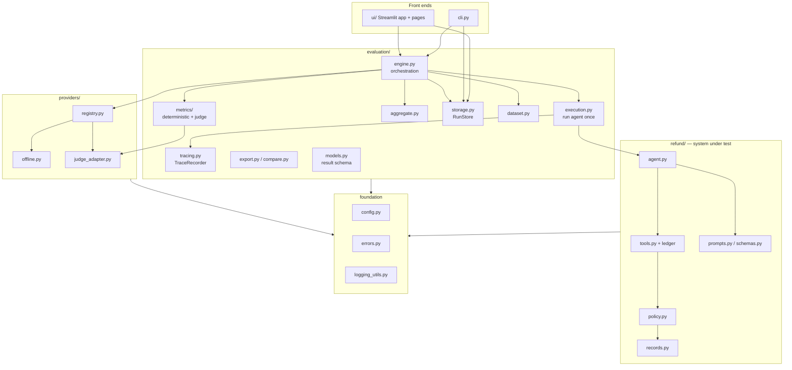
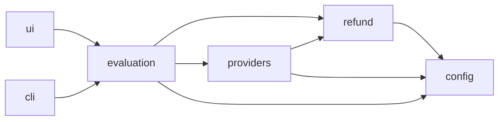
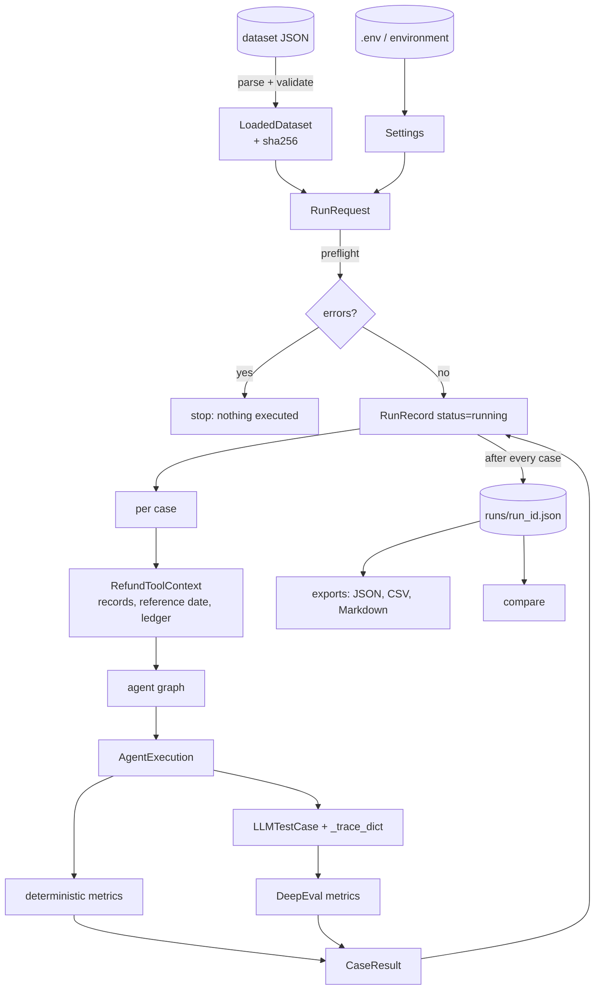
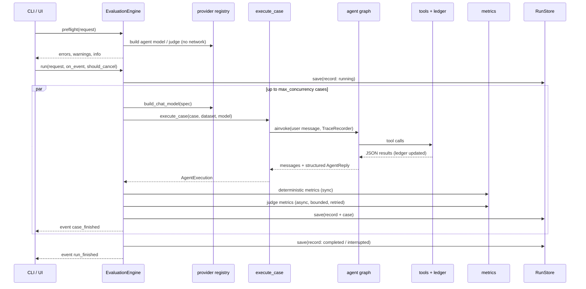
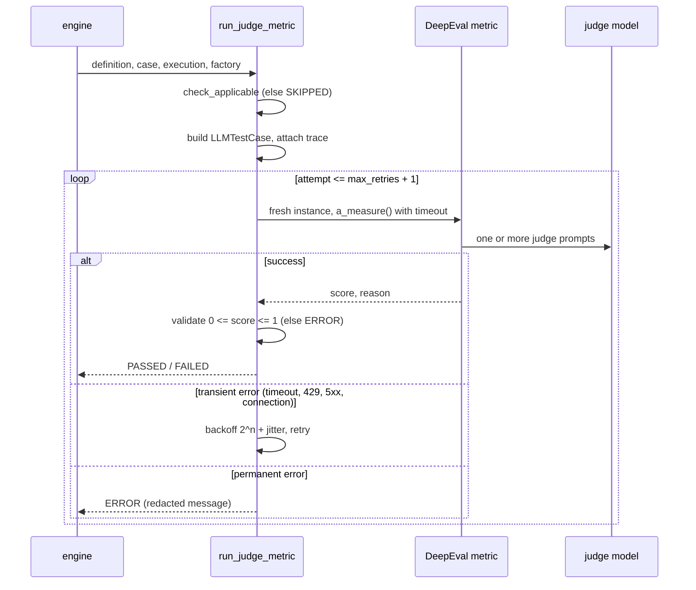
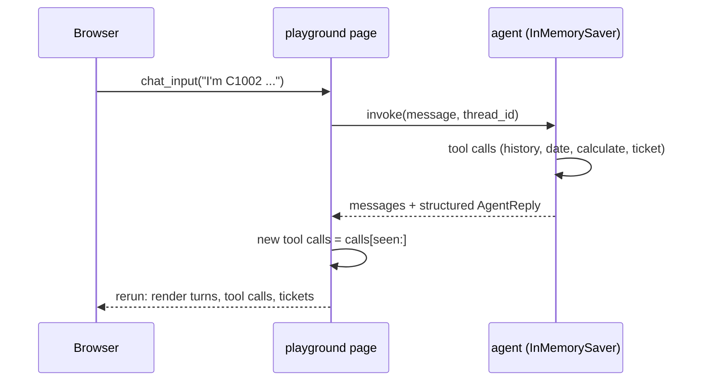
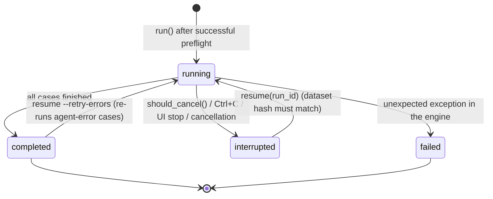

# Part III — Requirements and system architecture

## 10. Requirements

The authoritative list is `docs/PRODUCT_REQUIREMENTS.md`: 21 functional requirements (FR-1 …
FR-21), 8 non-functional requirements (NFR-1 … NFR-8) and 10 acceptance criteria (AC-1 …
AC-10). Chapter 87 maps each one to its implementation and evidence. In short:

* **Functional:** the refund agent and its policy (FR-1–4); datasets and reproducible dates
  (FR-5–6); execution capture (FR-7); deterministic and DeepEval metrics with thresholds and
  statuses (FR-8–10); aggregation, persistence, export, comparison and resume (FR-11–15);
  providers and preflight validation (FR-16–17); CLI, UI and interactive chat (FR-18–20); the
  bundled dataset (FR-21).
* **Non-functional:** works offline (NFR-1), reproducible (NFR-2), reliable (NFR-3), honest
  reporting (NFR-4), secure (NFR-5), maintainable (NFR-6), testable (NFR-7), predictable
  resource use (NFR-8).

## 11. Architecture overview

TraceGrade is one Python package with four layers and two front ends:

**Responsibilities.** The *foundation* provides settings, the exception hierarchy and
logging. *refund/* is the system under test and knows nothing about evaluation. *providers/*
turns a serialisable `ModelSpec` into a chat model or a DeepEval judge. *evaluation/* loads
datasets, runs the agent per case, scores, aggregates, stores and exports. The *front ends*
only translate user input into a `RunRequest` and render `RunRecord`s.

## 12. Module dependency rules

* `refund` never imports `evaluation` or `providers`; the agent chooses its structured-output
  strategy from the chat-model class name.
* `providers.offline` imports `refund.policy`/`records`/`schemas` (to apply the same rules).
  There are no import cycles: every module is imported during the test run (the UI pages
  through Streamlit's AppTest, `__main__` through a subprocess test) without error.
* No module performs I/O or network calls at import time.

## 13. Data flow

## 14. Component interactions — an evaluation run

## 15. Sequence — one judge metric

## 16. Sequence — a playground turn

## 17. Run state transitions

A case has its own status: `error` (agent did not complete), `failed` (≥1 metric failed),
`incomplete` (no failure, ≥1 metric error, or nothing evaluated) or `passed`.

## 18. Design decisions and trade-offs

The most consequential design decisions, with the main alternative considered:

| Decision | Chosen | Main alternative | Why |
|---|---|---|---|
| Ground truth for outcomes | Tool ledger + `refund_outcome` | Judge the reply text | Exact, free, independent of wording |
| Policy | Deterministic module + oracle test | Prompt only | One source of truth for guardrails, offline model and dataset checks |
| "Today" | Dataset reference date | Machine clock | Reproducibility |
| Trace capture | Own `TraceRecorder` | DeepEval `CallbackHandler` | DeepEval clears traces after use; avoid global state and cloud path |
| DeepEval usage | Call `a_measure` per metric | `deepeval.evaluate()` | Per-metric timeout/retry/error handling, own result model |
| Credential-free mode | Rule-based offline model | None / canned outputs | Exercise the real graph, tools and metrics |
| Storage | One JSON file per run | SQLite / server DB | Simple, inspectable, sufficient |
| UI | Streamlit multipage | JS front end | Python-first, as requested |
| Aggregation | Per-metric only | Weighted overall score | Do not mix exact checks with opinions |
| Agent retries | None at run level | Retry whole run | Tool side effects (tickets) |

The main trade-off accepted is a dependency on one private DeepEval attribute
(`LLMTestCase._trace_dict`). It is exercised by tests for all seven DeepEval metric classes,
so an incompatible DeepEval upgrade fails loudly in CI rather than silently.
